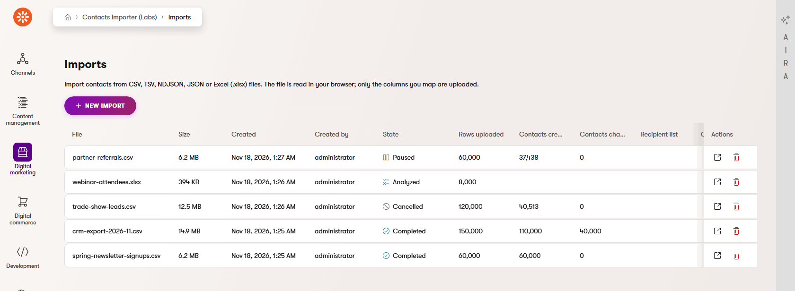
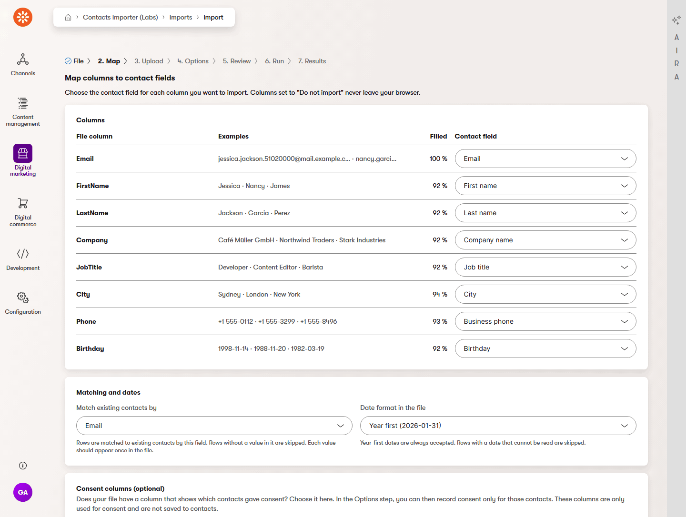
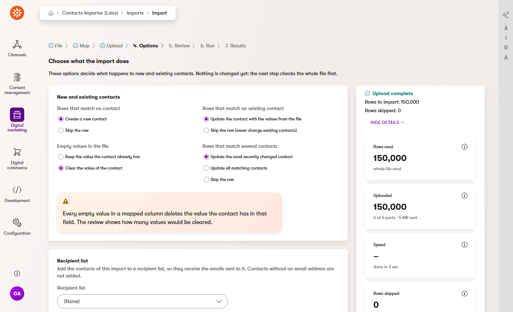
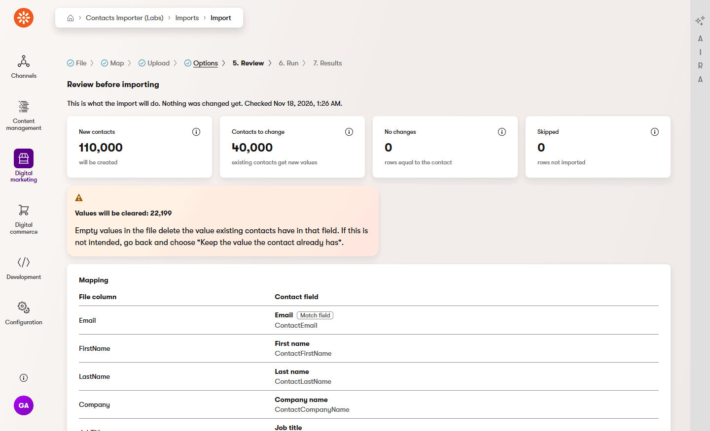
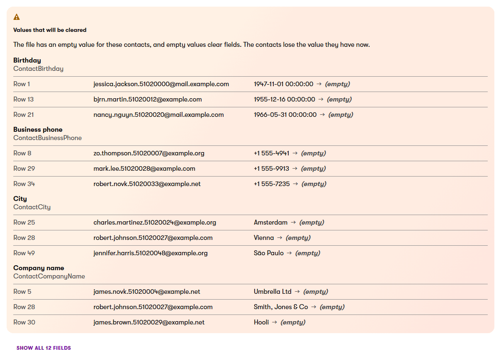
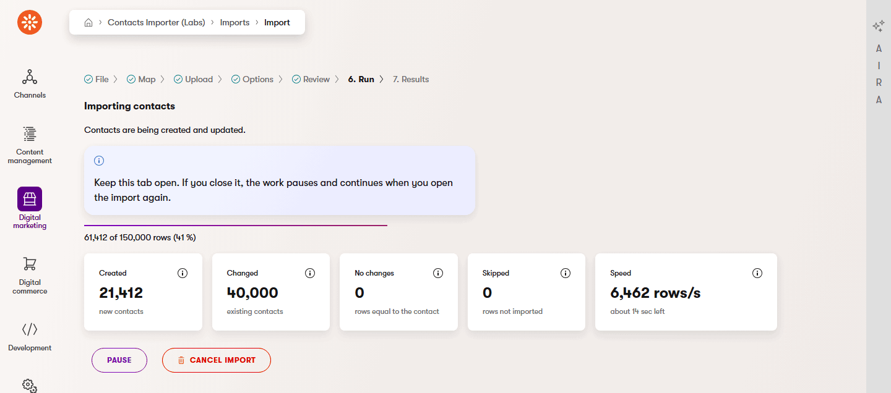
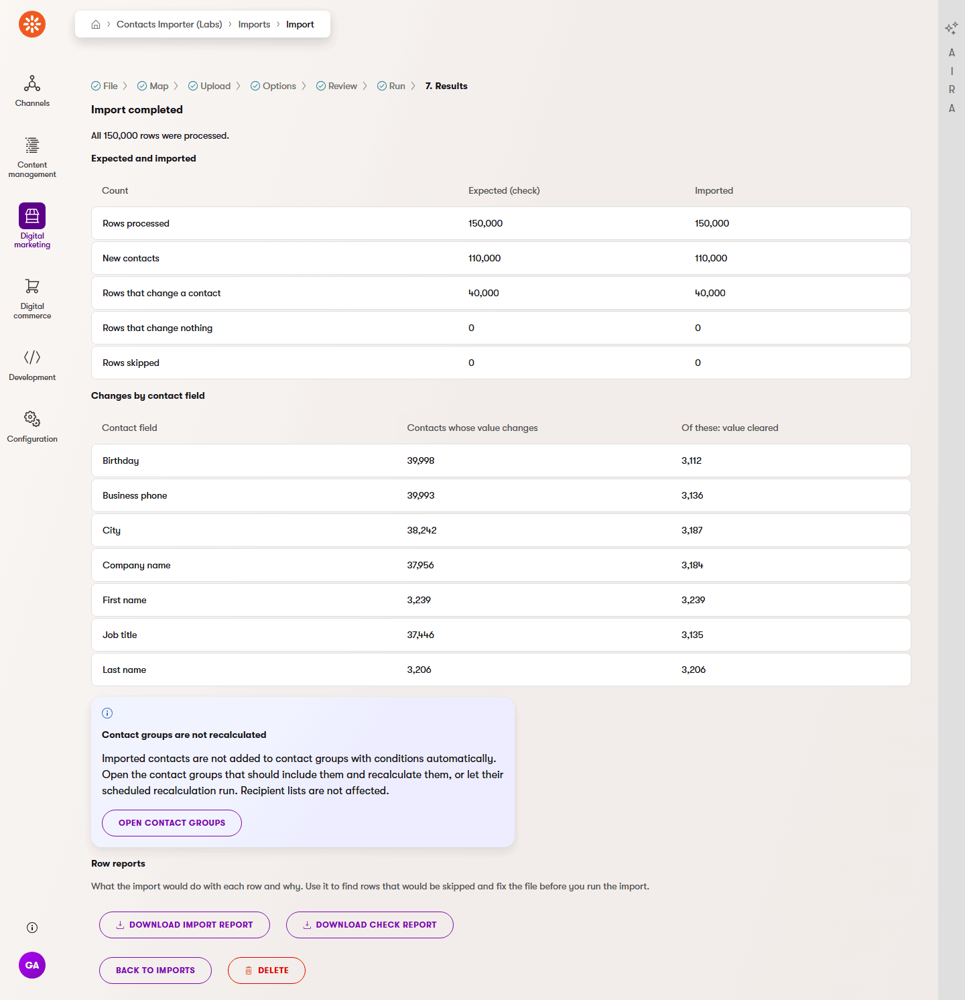

# Xperience by Kentico Labs: Contacts Importer

[](https://github.com/Kentico/.github/blob/main/SUPPORT.md#labs-limited-support) [](https://github.com/Kentico/xperience-by-kentico-contacts-importer/actions/workflows/ci.yml)

> [!NOTE]
> This package replaces `Kentico.Xperience.Contacts.Importer`, which is deprecated (its final release is 1.0.0-prerelease-5). Replace that package reference with `Kentico.Xperience.Labs.ContactsImporter.Admin` and use the namespace `Kentico.Xperience.Labs.ContactsImporter.Admin`. See [releases](https://github.com/Kentico/xperience-by-kentico-contacts-importer/releases).

## Description

Lets marketers import contacts into Xperience by Kentico from CSV, TSV, NDJSON, JSON and Excel (`.xlsx`) files, also gzipped (`.gz`) or zipped (`.zip`), with deduplication, dry runs, recipient list assignment and consent agreements. The file is read in the browser; only mapped columns are uploaded.

### Screenshots

Recent imports and their state:



Map: choose the contact field for each file column and the field that matches existing contacts.



Options: choose what the import does while the file uploads (upload details on the right).



Review: the check (dry run) shows what the import will change before anything is written.



Review also shows examples of changes, here values that an empty cell in the file will clear.



Run: progress and counts while the import runs. It can be paused, continued or cancelled.



Results: imported counts next to the counts the check expected.



### Limitations

Some behavior is intentional, for speed on large files. Details: [Limitations and documented choices](./docs/Usage-Guide.md#limitations-and-documented-choices).

- Contacts are written with set-based SQL: per-object event handlers, automation triggers and contact group recalculation do not run for imported contacts. Recalculate contact groups after an import.
- Caches are cleared by type keys, and fully only when an import completes. After a cancelled or failed import, clear the cache in the System application. Custom caches keyed only per contact stay stale until they expire.
- Clean data is expected: duplicate rows are applied in file order (last non-empty value wins). Rows without a valid match value are always skipped.
- Reference fields (country, state, contact status, owner) take IDs, not names.
- The browser tab drives the import: closing it pauses the import. Do not import during deployments.
- Only one import run at a time: a confirmed run that has not ended (also when paused) blocks the runs of other imports. Checks (dry runs) are not blocked.
- Contacts added to a recipient list get no double opt-in email. Bounce records are never changed.
- Web farm and SaaS need shared storage for the import files; see [Setup](./docs/Setup.md#storage).
- The Import contacts permission shows existing contact data (which match values exist, current field values in examples), without the Contacts application's permissions. See [Permissions](./docs/Setup.md#permissions).
- File size is limited (5 GB by default); request size limits and timeouts of the hosting apply.

## Requirements

### Library Version Matrix

| Xperience Version | Library Version    |
| ----------------- | ------------------ |
| >= 31.10.3        | 1.0.0-prerelease-5 |

### Dependencies

- [ASP.NET Core 10.0](https://dotnet.microsoft.com/en-us/download)
- [Xperience by Kentico](https://docs.kentico.com)

## Package Installation

Add the package to your application using the .NET CLI.

```powershell
dotnet add package --prerelease Kentico.Xperience.Labs.ContactsImporter.Admin
```

## Quick Start

1. Install the package (see [Package Installation](#package-installation)).
1. Register the services in your application's `Program.cs`:

   ```csharp
   using Kentico.Xperience.Labs.ContactsImporter.Admin;

   builder.Services.AddContactsImporter();
   ```

1. In **Role management**, give marketers the **View** and **Import contacts** permissions of **Contacts Importer (Labs)**. Users who add contacts to recipient lists or record consent also need **Confirm consent for imported contacts**. See [Permissions](./docs/Setup.md#permissions).
1. Web farm or SaaS: import files are stored under `~/App_Data/contacts-importer` by default and must be shared by all instances (and, on Azure App Service, registered for storage path mapping). See [Storage](./docs/Setup.md#storage).
1. Open **Contacts Importer (Labs)** in the **Digital marketing** category and select **New import**.

## Full Instructions

View the [Usage Guide](./docs/Usage-Guide.md) for more detailed instructions.

## Contributing

To see the guidelines for Contributing to Kentico open source software, please see [Kentico's `CONTRIBUTING.md`](https://github.com/Kentico/.github/blob/main/CONTRIBUTING.md) for more information and follow the [Kentico's `CODE_OF_CONDUCT`](https://github.com/Kentico/.github/blob/main/CODE_OF_CONDUCT.md).

Instructions and technical details for contributing to **this** project can be found in [Contributing Setup](./docs/Contributing-Setup.md).

## License

Distributed under the MIT License. See [`LICENSE.md`](./LICENSE.md) for more information.

## Support

[](https://github.com/Kentico/.github/blob/main/SUPPORT.md#labs-limited-support)

This project has **Kentico Labs limited support**.

See [`SUPPORT.md`](https://github.com/Kentico/.github/blob/main/SUPPORT.md#labs-limited-support) for more information.

For any security issues see [`SECURITY.md`](https://github.com/Kentico/.github/blob/main/SECURITY.md).
